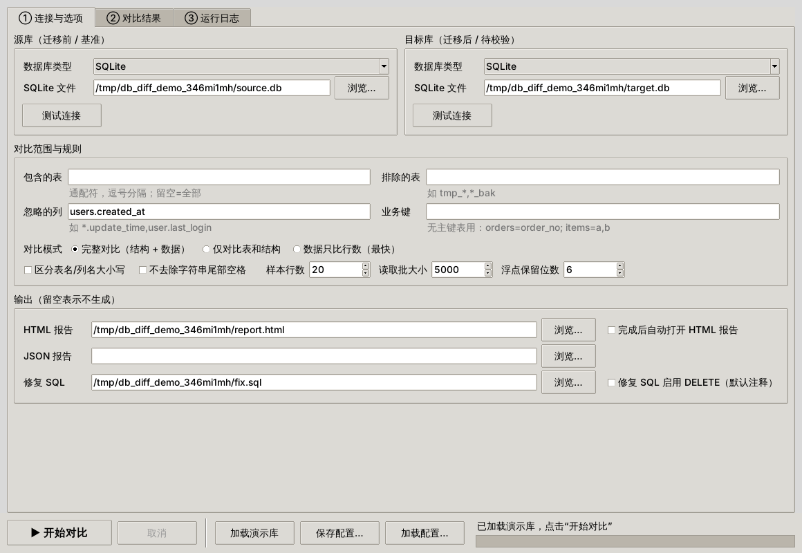
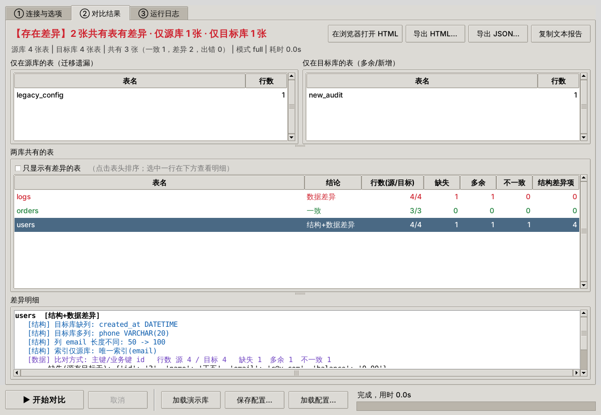

# DB Diff — 数据迁移对比工具

对比**迁移前（源库）**与**迁移后（目标库）**，一次性找出：

| 层级 | 检查内容 |
|---|---|
| **不同表** | 仅在源库的表（迁移遗漏）、仅在目标库的表（多余） |
| **相同表 · 结构** | 缺列/多列、类型、长度/精度、可空性、主键、索引、外键 |
| **相同表 · 数据** | 行数、缺失行、多余行、内容不一致的行（精确到列） |

支持 MySQL / MariaDB、PostgreSQL、Oracle、SQL Server、SQLite（基于 SQLAlchemy，其他库可用自定义 URL）。
提供 **图形界面**、**命令行** 和 **Windows exe** 三种用法，并可生成 HTML / JSON 报告与**修复 SQL**。

| 连接与选项 | 对比结果 |
|---|---|
|  |  |

## 快速开始

```bash
pip install sqlalchemy pymysql psycopg2-binary   # 驱动按需安装：pymysql / psycopg2-binary / oracledb / pyodbc
python db_diff_gui.py                            # 图形界面（点“加载演示库”可立即体验）
```

Linux 若提示没有 tkinter：`sudo apt install python3-tk`。需要 Python 3.9+。

### 命令行

```bash
python db_diff.py \
  --source "mysql+pymysql://u:p@10.0.0.1:3306/olddb?charset=utf8mb4" \
  --target "postgresql+psycopg2://u:p@10.0.0.2:5432/newdb" \
  --src-schema olddb --tgt-schema public \
  --exclude "tmp_*,*_bak" --ignore-columns "*.update_time" \
  --html report.html --json report.json --fix-sql fix.sql

python db_diff.py --demo     # 不连库，自动生成两个 SQLite 示例库演示
```

退出码：`0` 完全一致 · `1` 存在差异 · `2` 有报错 · `130` 被取消，可直接用于 CI / 迁移流水线。

常用参数：

| 参数 | 说明 |
|---|---|
| `--include` / `--exclude` | 表名通配符，逗号分隔 |
| `--ignore-columns` | 忽略列，如 `*.update_time,user.last_login` |
| `--key "orders=order_no; items=a,b"` | 为无主键表指定业务键 |
| `--schema-only` / `--count-only` | 只比结构 / 数据只比行数（最快，适合先摸底） |
| `--case-sensitive` | 区分表名/列名大小写（默认忽略，适合 MySQL→PG） |
| `--sample N` | 每类差异展示的样本行数（默认 20） |
| `--fix-sql FILE` `--with-delete` | 生成让目标库向源库看齐的 SQL；DELETE 默认注释 |

## 打包 Windows exe

在 Windows 上双击 `build_exe.bat`，在 `dist/` 得到 `DBDiff.exe`（GUI）和 `DBDiff-cli.exe`。
没有 Windows 机器：推送 `v*` 标签（如 `git tag v1.0.0 && git push origin v1.0.0`），GitHub Actions 会自动打包并发布到 Releases。

## 原理

- 两库各**流式**扫描一次，每行先**归一化**再哈希：Decimal/float 表示差异、CHAR 补空格、带时区时间、`DATE` 与零点 `DATETIME`、JSON 键顺序等不会误报；内存占用约每行几十字节。
- 有主键（或 `--key`）：`{键 → 行哈希}` 比较，得到缺失 / 多余 / 不一致；键不唯一时自动降级为整行哈希比较。
- 无主键：整行哈希多重集合比较（能发现数量差异，无法区分“修改”与“删+增”）。
- 仅在有差异时才回扫取样本、生成修复 SQL。
- 类型按“同族”比较（`INT/BIGINT/TINYINT`、`VARCHAR/TEXT`、`DATETIME/TIMESTAMP` 等视为一致），减少跨库迁移的噪音。

## 注意事项

- **修复 SQL 请先备份并人工复核再执行。** 其中 INSERT/UPDATE 只包含参与对比的列；无主键表的多余行不会生成 DELETE。
- 密码不会写入报告和保存的配置文件。
- MySQL 的 JSON 列（字符串）与 PostgreSQL 的 jsonb（对象）表示可能不同，建议用 `--ignore-columns` 排除或另行校验。
- 修复 SQL 的字面量按 MySQL / PostgreSQL / SQLite 处理，其他方言（如 Oracle 日期）需自行调整。
- SQL Server 需系统安装 ODBC Driver 17/18。

## 开发与测试

```bash
pip install -r requirements-dev.txt
pytest -q          # 17 项测试，全部基于 SQLite，无需外部数据库
```

测试覆盖：表级/结构/数据对比、值归一化、复合主键、无主键、键重复降级、忽略列、
**“对比 → 执行修复 SQL → 再对比应完全一致”的往返测试**、取消时修复 SQL 的安全标记等。

## 许可证

MIT，见 [LICENSE](LICENSE)。
